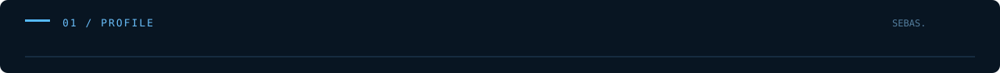
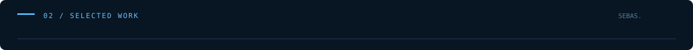
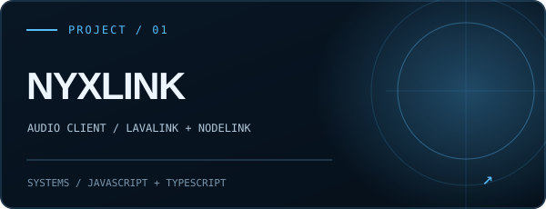
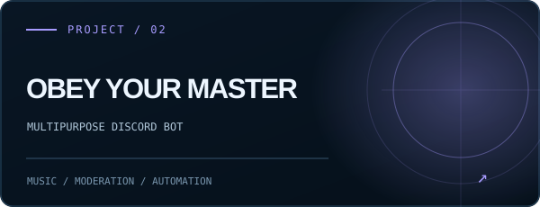
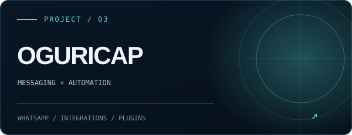
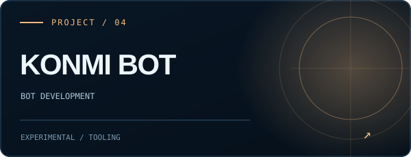
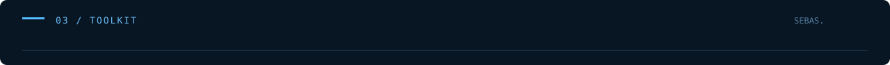
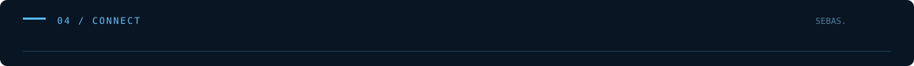

  

### 𝚂𝚎𝚋𝚊𝚜 · Independent Software Developer

**SOFTWARE / SYSTEMS / SOUND**

Writing code. Exploring systems. Building and refining what matters.

  

 

<table>
<tr>
<td width="57%" valign="top">

### Hey, I'm Sebas.

A developer from **Paraguay** exploring **software architecture, APIs, automation, audio systems and developer tools**.

I like to understand what happens behind the interface, break complicated problems into smaller pieces, and turn experiments into projects I can improve over time.

Most of my public work involves **Discord bots**, **audio clients** and **messaging automation**.

</td>
<td width="43%" valign="top">

**developer.json**

~~~json
{
  "name": "Sebas",
  "location": "Paraguay",
  "interests": [
    "software architecture",
    "audio infrastructure",
    "automation",
    "developer experience"
  ],
  "approach": "build → test → refine"
}
~~~

</td>
</tr>
</table>

 

SELECTED WORK / EXPLORE MY REPOSITORIES

 

<table>
<tr>
<td width="50%" valign="top">
 
Audio-client infrastructure for Discord bots, working with Lavalink and NodeLink.  
<a href="https://github.com/SebasLoadJs/NyxLink"><b>Explore the code ↗</b></a>
</td>
<td width="50%" valign="top">
 
Multipurpose Discord bot project covering music, moderation and modular features.  
<a href="https://github.com/SebasLoadJs/OBEY-YOUR-MASTER"><b>Explore the code ↗</b></a>
</td>
</tr>
<tr>
<td width="50%" valign="top"> 
 
WhatsApp automation project exploring plugins, integrations and management tools.  
<a href="https://github.com/SebasLoadJs/OguriCap-Bot"><b>Explore the code ↗</b></a>
</td>
<td width="50%" valign="top"> 
 
An experimental bot-development project in my collection of technical work.  
<a href="https://github.com/SebasLoadJs/KONMI-BOT-"><b>Explore the code ↗</b></a>
</td>
</tr>
</table>

 

### Technology & interests

  

JavaScript · TypeScript · Node.js · discord.js · REST APIs · WebSockets

Lavalink · NodeLink · Software Architecture · Automation

 

<b>↳ Engineering approach</b>

 

- **Structure:** Define responsibilities, interfaces and boundaries between modules.
- **Maintenance:** Prefer readable code and predictable behavior over unnecessary complexity.
- **Reliability:** Test core flows, inspect failures, document the important decisions.
- **Experience:** Think about both the end user and the developer maintaining the project.
- **Iteration:** Research, build, evaluate and refine.

<b>↳ Things I'm exploring</b>

 

- **NyxLink:** Lavalink, NodeLink, audio-client interfaces and error handling.
- **OBEY:** Modular Discord features, music systems and user experience.
- **Tooling:** Developer workflows, testing, documentation and project structure.

 

### Let's build something meaningful.

Software, systems and open-source experiments.

 

  

SEBAS © 2026 · Build / Explore / Refine

