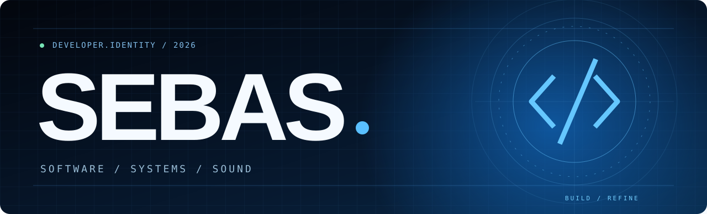

# 𝚂𝚎𝚋𝚊𝚜

**SOFTWARE / SYSTEMS / SOUND**

*Building, exploring and refining software — one project at a time.*

---

### 01 / About

I'm **Sebas**, a developer interested in software architecture, automation, audio infrastructure and building tools that people can actually use.

I value modular design, maintainable code and thoughtful developer experience.

### 02 / Selected projects

| Project | Focus | Repository |
|:--|:--|:--|
| **NyxLink** | Audio client for Discord bots, Lavalink and NodeLink | [Explore →](https://github.com/SebasLoadJs/NyxLink) |
| **OBEY YOUR MASTER** | Multipurpose Discord bot and modular systems | [Explore →](https://github.com/SebasLoadJs/OBEY-YOUR-MASTER) |
| **OguriCap Bot** | WhatsApp bot, automation and plugins | [Explore →](https://github.com/SebasLoadJs/OguriCap-Bot) |
| **KONMI BOT** | Bot development | [Explore →](https://github.com/SebasLoadJs/KONMI-BOT-) |

### 03 / Areas of interest

`TypeScript` · `JavaScript` · `Node.js` · `Discord.js` · `APIs` · `System Architecture` · `Audio Systems`

### 04 / Connect

**[GitHub](https://github.com/SebasLoadJs)** · **[Portfolio](https://SebasLoadJs.github.io/)**

This repository contains the source for my personal portfolio. Projects are continuously evolving.
